# CityU Credential Chain

A university activity credential platform for CityU. Schools issue non-transferable Soulbound Tokens (SBTs), students collect them in their wallets, and enterprises view verified experiences by wallet address.

The prototype uses Ethereum Sepolia. Only authorized issuers can issue or revoke credentials; public viewers have read-only access.

## Role Model

| Entry | Role |
| --- | --- |
| School — Administrator | Manage who can create activities and issue credentials. |
| School — Activity Creator | Publish activities, review applications, and issue or revoke SBTs. |
| Student | Submit participation evidence, track applications, and view owned SBTs. |
| Enterprise | Enter a student wallet address to view public CityU credentials and their current validity. |

The administrator role is part of the intended design. The screenshots below show the activity creator, student, and enterprise workflows.

## Functions

### 1. CityU Activity Feed

Browse published CityU activities, read participation requirements, and apply for a credential.

### 2. Activity Creation

Create an activity with a title, credential type, description, claim limit, and optional public IPFS metadata URI.

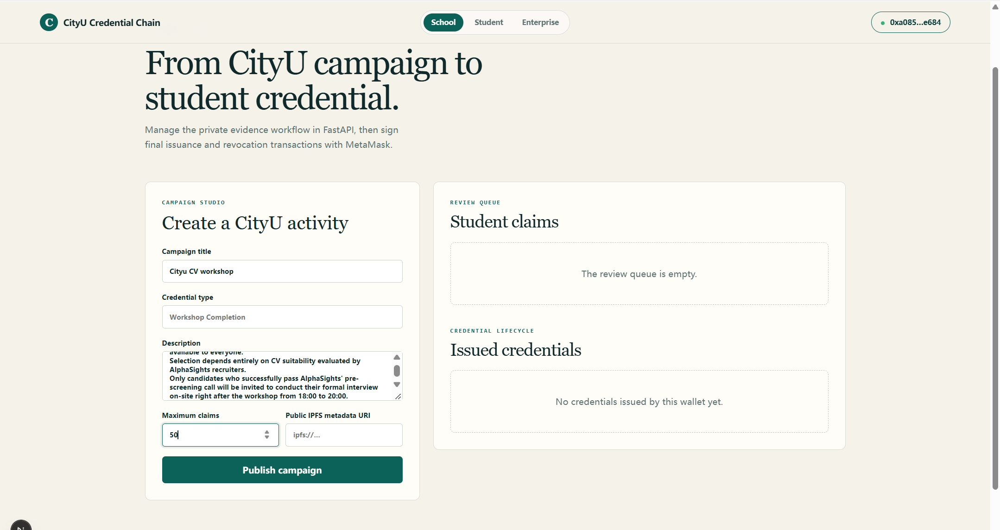

Additional activity creation screenshot

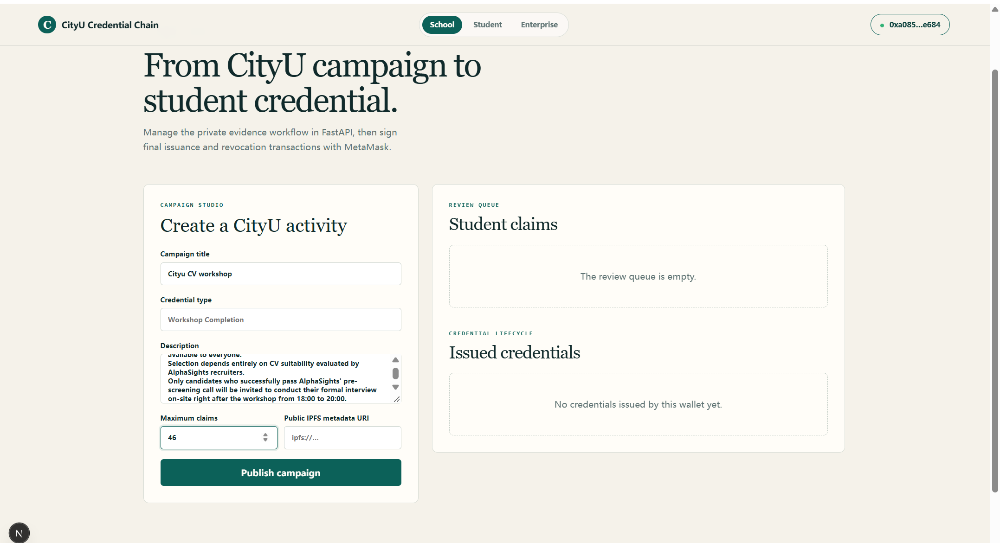

### 3. Credential Applications

Connect a student wallet and submit participation evidence as a PDF, JPG, or PNG. Evidence files remain private; their hash provides a link to the credential proof.

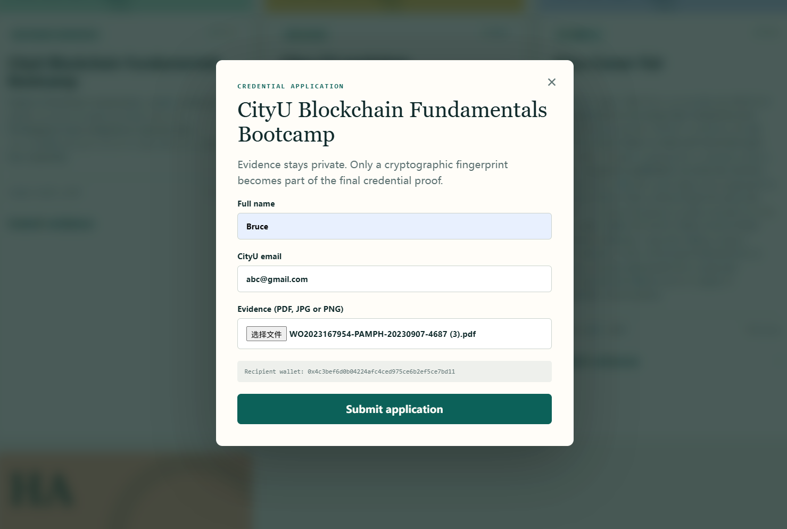

### 4. Application Review

Activity creators approve or reject student claims. Approval and on-chain issuance are separate steps.

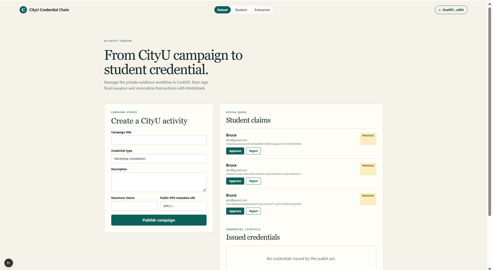

### 5. SBT Issuance

Issue approved credentials through MetaMask and wait for the Sepolia transaction to confirm.

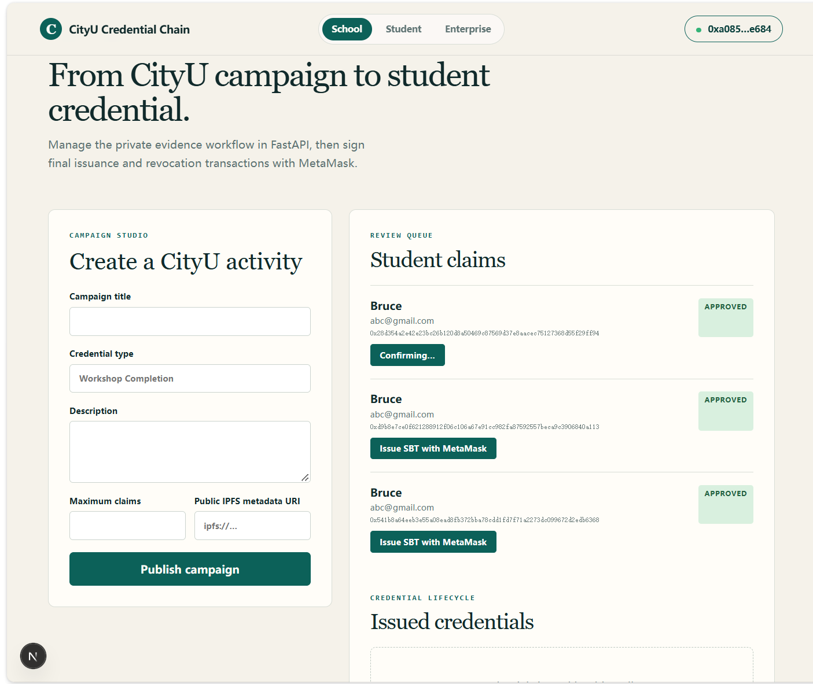

### 6. Student Credential Wallet

Track application status and view owned SBTs, including the issuer, token ID, issue date, validity, and transaction link. Credentials cannot be transferred between wallets.

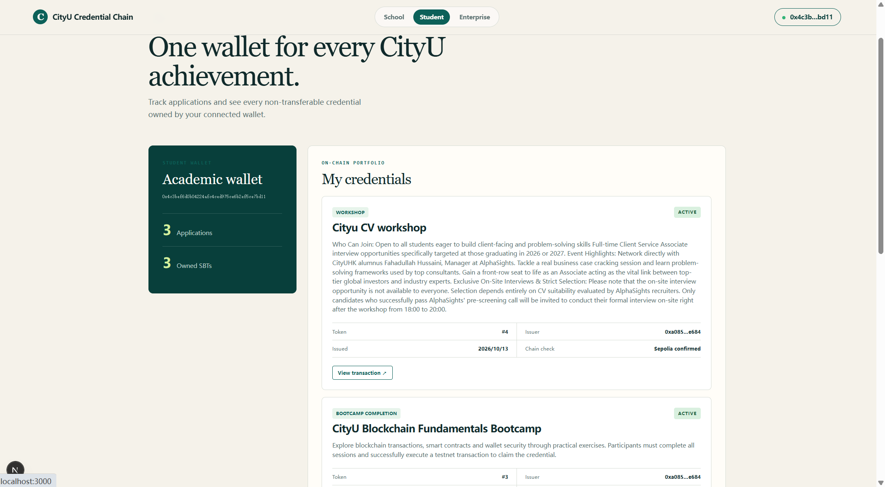

Additional student wallet screenshots

**Pending applications**

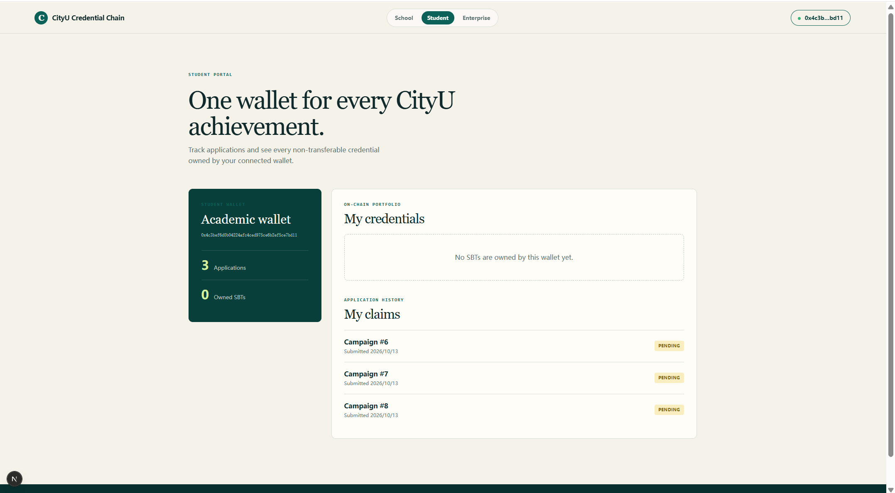

**Approved applications awaiting issuance**

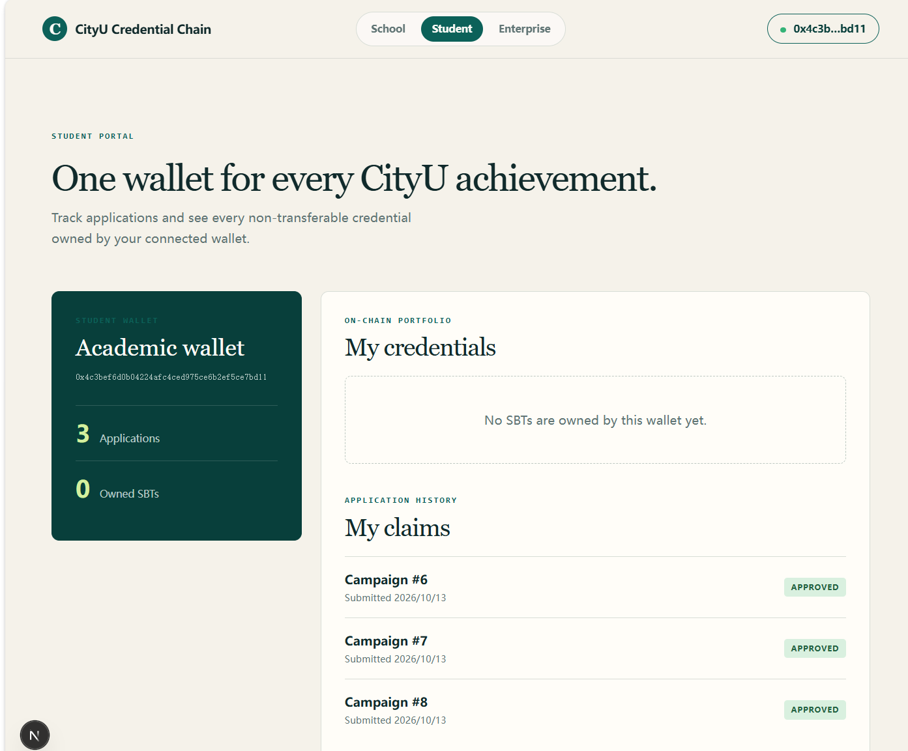

**Credential details**

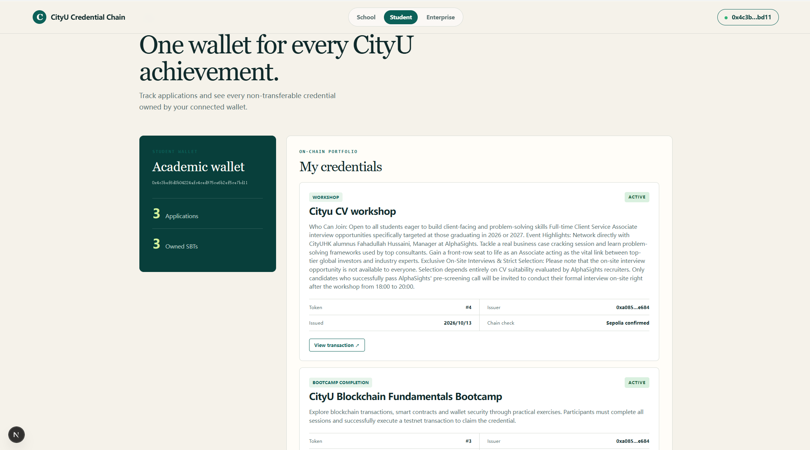

**Wallet overview**

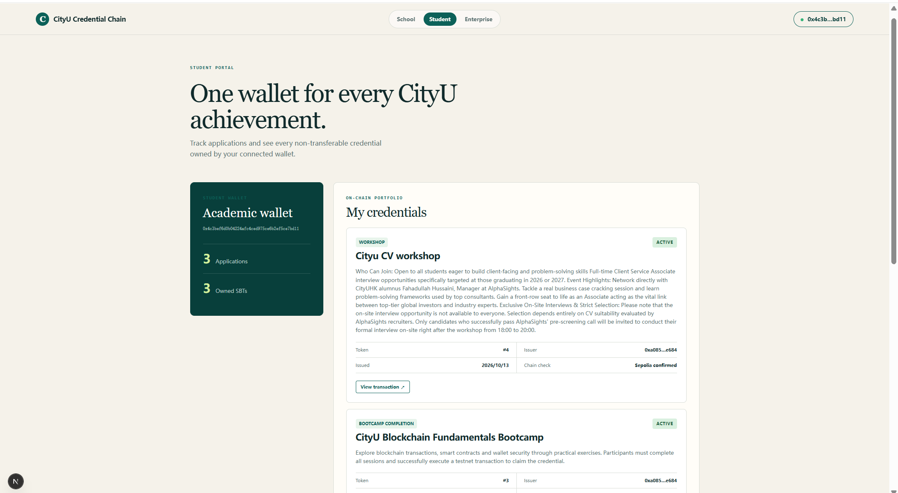

### 7. On-Chain Transaction Records

Open the credential transaction on Sepolia Etherscan to inspect its minting record, issuer, recipient, and confirmation status.

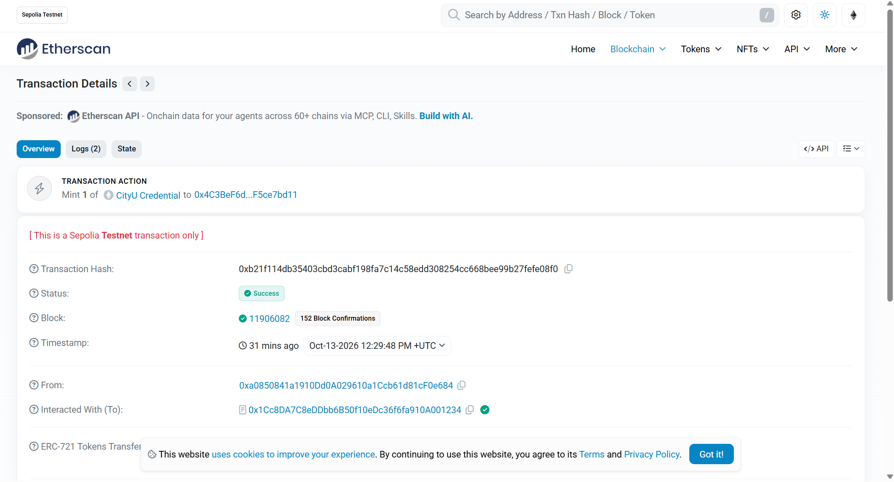

### 8. Enterprise Experience Lookup

Enter a student wallet address to view all CityU SBTs held by that wallet and their current on-chain validity. No login or student approval is required. This read-only view shows public credential facts while keeping evidence files and contact details private.

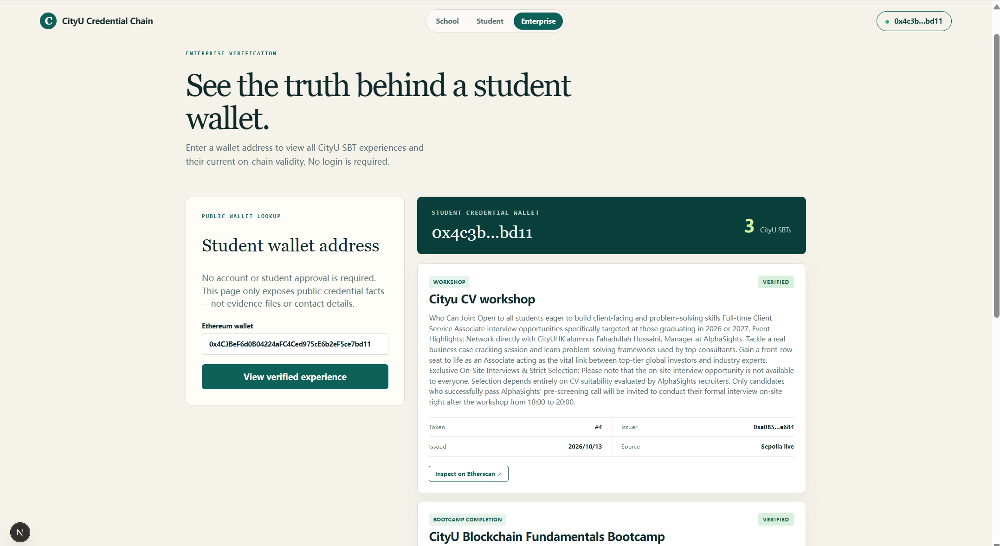
